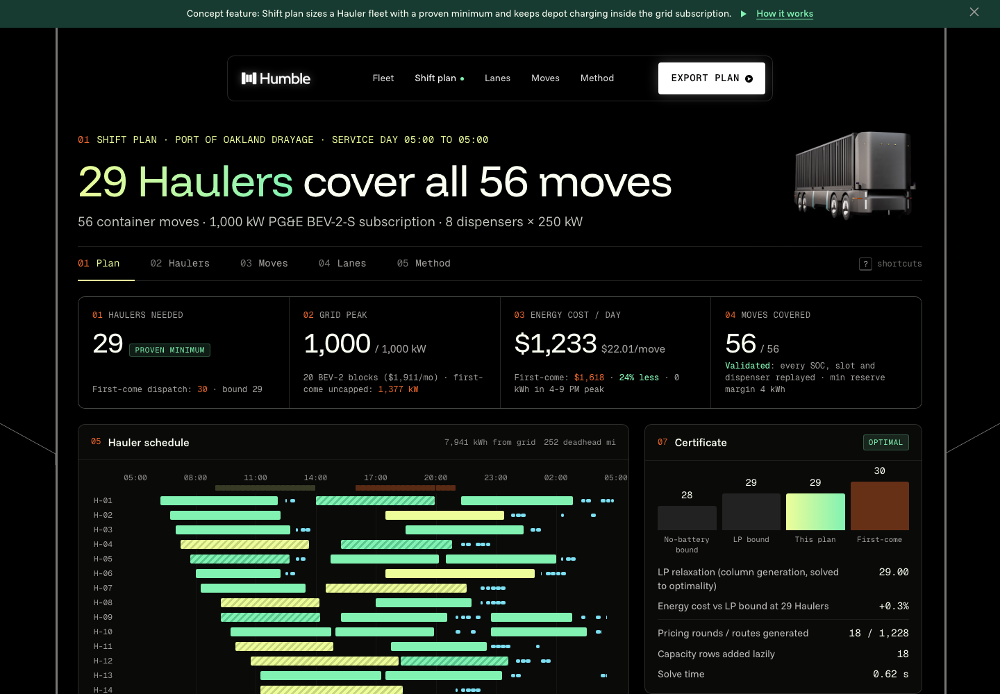

# Shift plan for Humble Hauler fleets

**Live demo:** https://mohith26.github.io/humble-shift-planner/

Humble is taking the Hauler into port drayage and plant-to-warehouse pilots, and an autonomous fleet can work the night gates as well as the day gates. Once there is no driver shift, two things decide how many Haulers an operator needs: the 200-mile battery and the depot's grid connection. This is a concept planner that takes a day of container moves and returns the smallest Hauler fleet that can cover them, with a certificate that no smaller fleet exists, plus a 15-minute charging schedule that stays inside a PG&E Business EV subscription. On a 56-move test day out of the Port of Oakland (synthetic moves, real roads and elevation), it covers everything with **29 Haulers**, proven minimum, on a 1,000 kW subscription and still needs only 29 at 750 kW. First-come dispatch with charge-on-arrival needs 30 Haulers and peaks at **1,377 kW**, and it cannot recharge the fleet by 05:00 on 800 kW or less. One Hauler-specific lever: the Hauler is the chassis, so it waits under the box during every live unload. A 150 kW charger at the customer dock turns that wait into charging, and the same day then needs **28 Haulers on a 500 kW depot** (proven), where without dock charging 500 kW cannot work at all.

## How it works

1. **Moves on real roads.** Every terminal, depot and destination leg is an OSRM route on OpenStreetMap, resampled every 250 m with NASA SRTM 30 m elevation (Altamont Pass is in the data). Driving speed is capped at the Hauler's 55 mph. Terminal turn times are the Port of Oakland Portal's published averages.
2. **Energy per move.** Rolling resistance, aerodynamic drag, grade with regenerative braking, and the autonomy compute and sensor load, at the gross weight of each leg (loaded out and empty back for imports, the reverse for exports). The pack size is derived so the published 200-mile range holds at a 10 t payload (364 kWh), and the curb weight uses the published "20% lighter than a tractor plus chassis". The model also tracks the worst point of every move, not only its end.
3. **Certified lower bound.** Ignoring batteries, the minimum fleet is a minimum path cover (moves minus a maximum matching). With batteries and the grid, the planner solves the set-covering LP over all feasible Hauler days by **column generation**. New days come from a resource-constrained shortest path over the time-ordered moves (labels hold reduced cost and battery energy, with dominance). Charging inside a depot visit is priced exactly: the cheapest whole 15-minute blocks under the LP's power and dispenser prices, plus the best top-off block by enumeration. Site-power and dispenser rows are added lazily, only for intervals the LP overloads. When pricing finds no improving day, ⌈LP⌉ is a valid lower bound on the fleet.
4. **A plan that meets it.** Price-and-dive fixes the day with the largest LP value that still fits the remaining site power, re-solves with new columns, and backtracks with seeded restarts. A polish pass moves charging blocks to cheaper intervals when the Hauler's state of charge allows it. An independent validator then replays every Hauler: arrival times, state of charge at the worst point of every move, the 90% charge ceiling, the 10% reserve, the overnight recharge, coverage, site power and dispensers.
5. **Tariff.** PG&E Schedule BEV, BEV-2-S, effective Mar 1 2026: peak 4-9 PM $0.36977/kWh, off-peak $0.15654, super off-peak 9 AM-2 PM $0.13327, $95.56 per 50 kW block, $3.82/kW overage on the worst 15 minutes.

The app (static HTML/JS, no build step) shows the plan, a Gantt of every Hauler, the depot load against the subscription, the certificate, the fleet-vs-subscription frontier, per-Hauler state-of-charge drill-downs, per-move route maps, elevation and energy breakdowns, and a what-if panel that re-plans in a Web Worker. Deep links work (`?kw=750#/hauler/H-07`, `?kw=500&dock=150`), applied plans persist in localStorage, and the dispatch sheet exports as CSV or JSON. Keyboard: `1`-`5` views, `R` re-plan, `A` apply, `E` export, `J`/`K` next Hauler, `/` search, `?` help.

## Results (data/results.json, seed 20261111)

56 moves, 8 dispensers × 250 kW, 10% reserve, 90% daily ceiling.

| Subscription | Plan Haulers | LP bound | Proven | Plan energy $/day | First-come Haulers | First-come recharges by 05:00 |
|---|---|---|---|---|---|---|
| 700 kW | not found (time budget) | 29 | no | - | 30 | no |
| 750 kW | 29 | 29 | yes | $1,410 | 30 | no |
| 800 kW | 29 | 29 | yes | $1,408 | 30 | no |
| 900 kW | 29 | 29 | yes | $1,381 | 30 | yes |
| 1,000 kW | 29 | 29 | yes | $1,233 | 30 | yes |
| 1,200 kW | 29 | 29 | yes | $1,233 | 30 | yes |
| 1,400 kW | 29 | 29 | yes | $1,234 | 30 | yes |

With a 150 kW charger at each customer dock (used only during live unload or load, never above the charge the Hauler left with):

| Depot subscription | Plan Haulers | LP bound | Proven | Depot kWh | Dock kWh | First-come Haulers |
|---|---|---|---|---|---|---|
| 400 kW | not found | 28 | no | - | - | 29 (can't recharge) |
| 500 kW | 28 | 28 | yes | 4,157 | 3,537 | 29 (can't recharge) |
| 750 kW | 28 | 28 | yes | 4,138 | 3,537 | 29 |
| 1,000 kW | 28 | 28 | yes | 4,138 | 3,537 | 29 |

At 1,000 kW the plan puts 0 kWh in the 4-9 PM peak (first-come: 1,749 kWh) and its energy cost is within 0.3% of the LP bound at 29 Haulers. First-come dispatch without a limit peaks at 1,377 kW, which would need a 28-block (1,400 kW) subscription.

## Tests

`node --test test/*.test.mjs` (15 tests, also run in GitHub Actions):

- revised simplex vs brute force on 40 random covering LPs, charging choice vs brute force on 30 random windows (randomized property tests)
- **certified fleet equals a brute-force optimum** (set partitions with an independent one-Hauler feasibility oracle) on 6 random tiny days
- headline reproduction: 29 Haulers proven at 1,000 kW and at 750 kW, first-come needs 30 and fails at 750 kW
- dock charging: never above the start charge, and 28 Haulers proven on 500 kW where the plain depot is infeasible
- validator catches a missing charge, a double-covered move and an over-subscribed site
- energy physics (55 mph cap, mass, Altamont climb), PG&E tariff periods and block math, pack size vs the published range, generator determinism, polish never raises cost, README numbers match the results file

Regenerate everything: `node scripts/fetch_routes.mjs` (public APIs, about 3 minutes) then `node scripts/generate.mjs`.

## Honest limitations

- The move list, payloads and dock times are synthetic (seeded); roads, elevation, tariff and terminal turn times are public data. No Humble data is used.
- Pack size, drag area, rolling resistance and compute load are engineering assumptions sized from Humble's published range, speed and weight claims.
- "Proven minimum" is for this model: fixed appointment times, one depot, deterministic travel times with a simple peak-hour multiplier, and charging in whole 15-minute blocks at dispenser power (plus one top-off block). Continuous power modulation could do slightly better than the model allows.
- The integer search is a heuristic. When it does not reach the bound (700 kW here, within the time budget) the gap is shown rather than hidden.
- No charging taper above 90%, no battery degradation cost, no en-route charging. Dock charging is a what-if: it assumes a charger at every customer dock, priced at the same BEV rate as the depot.

## Prior art and what is new here

Electric vehicle scheduling with charging (E-VSP) is an established research problem, and column generation is the textbook method for it. Optibus ships EV scheduling for transit buses, and depot charging tools (TOGL, Kempower ChargEye, Synop, BEV Ready) schedule charging around a fixed duty plan. I did not find a public tool that sizes an autonomous drayage fleet and its depot charging together with a certificate of optimality, or that treats the PG&E BEV subscription level as a decision with its fleet-size trade-off. Humble's public material describes 24/7 charging support and live battery telemetry but no planning tool. The Hauler-specific parts here are the live unload (the Hauler is the chassis, so it stays under the box at the dock), the 55 mph cap, and the 24-hour gate schedule an autonomous fleet can work.

## Run locally

Any static server: `python3 -m http.server` in this folder, then open http://localhost:8000. Core logic is in `core/planner.mjs` (no dependencies).

Unofficial concept demo by Mohith Gajjela. Not affiliated with Humble Robotics. Synthetic move list on public data.
